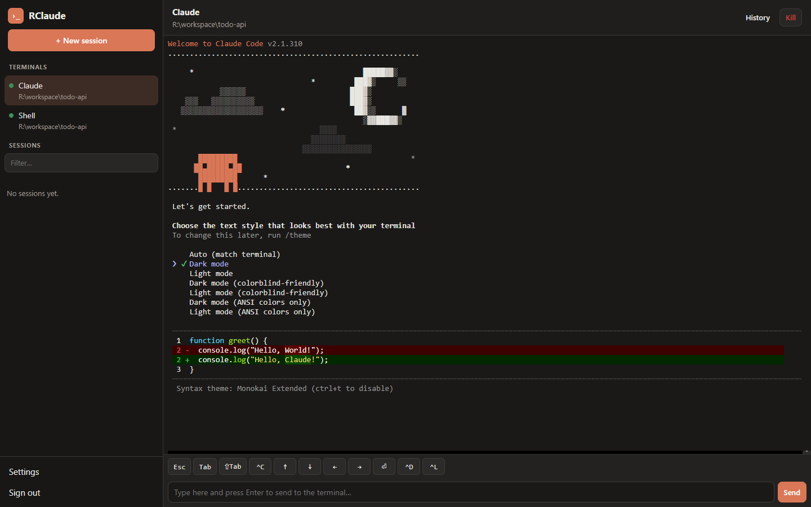
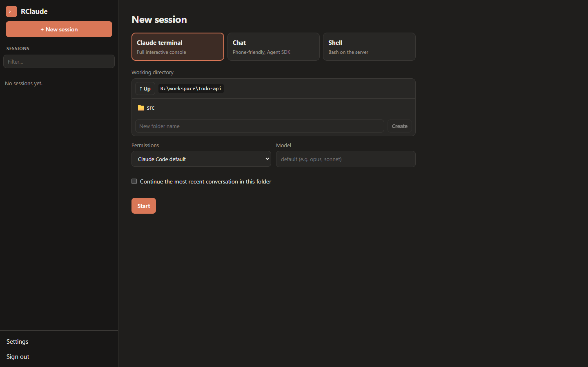
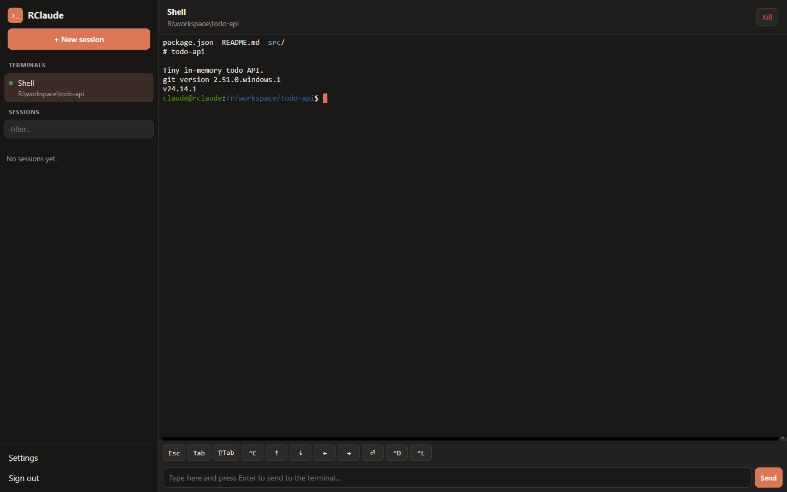
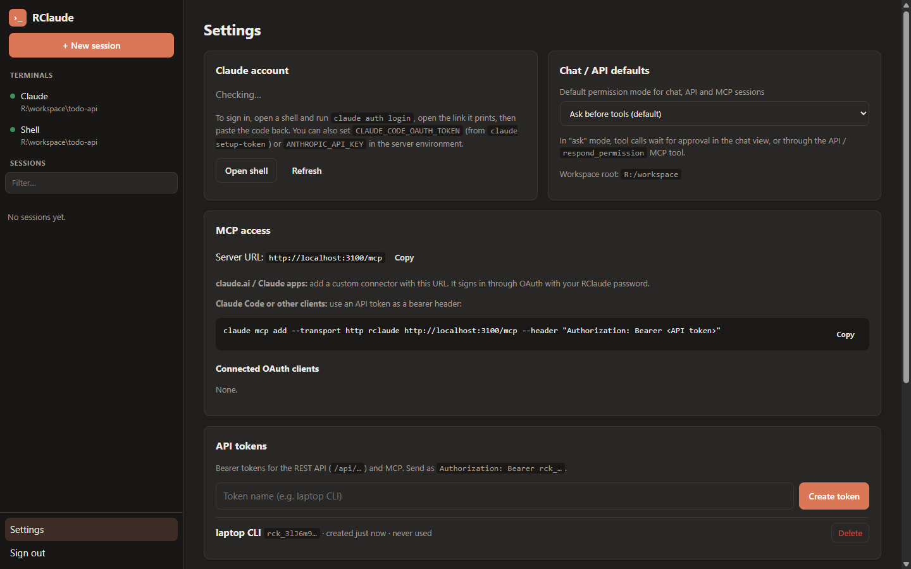
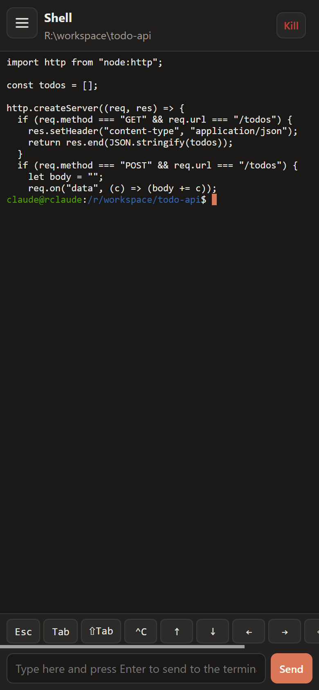
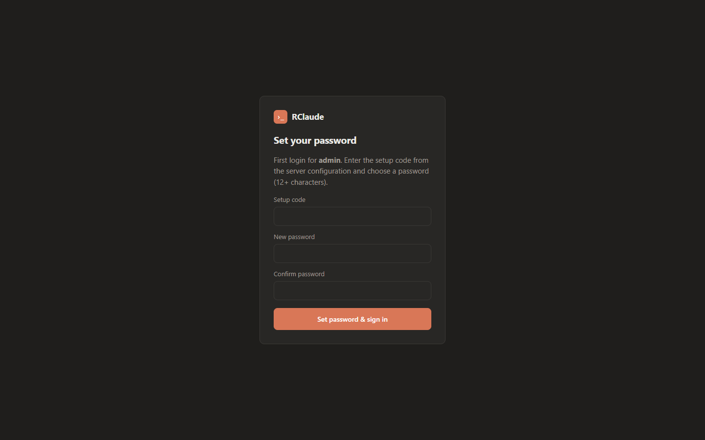

# RClaude

Remote access to Claude Code: a web console, a REST API and an MCP server, all for one user.

- **Terminal mode**: the real interactive `claude` TUI in the browser (xterm.js over a WebSocket to a server-side PTY). Terminals keep running when the tab closes, so you can reattach from another device. There's also a plain shell.
- **Chat mode**: a phone-friendly view driven by the [Claude Agent SDK](https://code.claude.com/docs/en/agent-sdk). It streams replies, and tool permission prompts and `AskUserQuestion` show up as buttons.
- **Sessions**: every conversation is a normal Claude Code session (`~/.claude/projects/...`). List, open, rename and delete them, or resume one in either mode.
- **API**: everything the UI does, over REST with bearer tokens.
- **MCP**: a Streamable HTTP endpoint at `/mcp`, so other agents (claude.ai connectors, Claude Code, ...) can start and continue sessions.

## Screenshots

| | |
|---|---|
|  |  |
| **Claude terminal**: the real `claude` TUI (here its first-run screen) | **New session**: pick a mode, a folder and a permission mode |
|  |  |
| **Shell**: bash in the container (or on the host in host mode) | **Settings**: Claude login status, MCP URL, API tokens |

<p>
  
  
</p>

On a phone the terminal gets a key bar (Esc, Tab, Ctrl+C, arrows) and a plain text input. The first login asks for the setup code from the server's environment.

## Install on Coolify

You need a [Coolify](https://coolify.io) server and a domain (or subdomain) pointing at it.

1. **New resource.** In your project: **+ New → Public Repository**, URL `https://github.com/Lunat1q/RClaude`, branch `main`. (Fork it first and pick **Private Repository (GitHub App)** if you want to change things or auto-deploy your own commits.)
2. **Build pack: Dockerfile.** Coolify finds the `Dockerfile` at the repo root. Set **Ports Exposes** to `3000`.
3. **Domain.** Under **General → Domains** enter `https://claude.example.com`. Coolify's proxy issues the certificate. WebSockets (`/ws/terminals/...`) work through it without extra config.
4. **Environment variables** (**Environment Variables** tab):

   ```env
   PUBLIC_URL=https://claude.example.com
   RCLAUDE_SETUP_CODE=<a long random string>
   # optional
   RCLAUDE_USERNAME=admin
   ```

   `PUBLIC_URL` must match the domain exactly: it's the OAuth issuer for MCP clients and turns on secure cookies. Generate the setup code with `openssl rand -hex 24`.
5. **Persistent storage** (**Persistent Storage → + Add → Volume Mount**), two volumes:

   | Name | Destination path | Holds |
   |---|---|---|
   | `rclaude-home` | `/home/claude` | Claude login, session history, the app DB, git/gh config |
   | `rclaude-workspace` | `/workspace` | Your projects |

   Without these, every redeploy logs Claude out and wipes your history and code.
6. **Deploy.** The first build takes a few minutes (it compiles `node-pty` and installs the Claude Code binary). The container has a health check on `/healthz`.
7. **First login.** Open the domain, enter the setup code and choose a password (12+ characters). Setup is disabled after that, so you can remove `RCLAUDE_SETUP_CODE` and redeploy.
8. **Sign in to Claude.** **Settings → Open shell**, run `claude auth login`, open the link, paste the code back. Or start a Claude terminal and follow its first-run prompts. Or set `CLAUDE_CODE_OAUTH_TOKEN` (from `claude setup-token` on any machine) or `ANTHROPIC_API_KEY` as an env var.
9. **Optional: git.** In the shell, `gh auth login` and `git config --global user.name/user.email`. Both persist in the `/home/claude` volume.

Then connect MCP clients from **Settings → MCP access** (see [MCP](#mcp)).

> **Security:** whoever logs in gets a shell and a Claude Code with full tool access inside the container. Use a strong password, keep the setup code secret, and consider putting the UI behind SSO (below). In host mode it's a shell on the host.

### Without Coolify

Any Docker host works:

```sh
docker build -t rclaude https://github.com/Lunat1q/RClaude.git
docker run -d --name rclaude -p 3000:3000 \
  -e PUBLIC_URL=https://claude.example.com \
  -e RCLAUDE_SETUP_CODE="$(openssl rand -hex 24)" \
  -v rclaude-home:/home/claude -v rclaude-workspace:/workspace \
  rclaude
```

Put a TLS reverse proxy in front of it (with WebSocket support) and read the setup code back with `docker inspect rclaude | grep SETUP`.

## Auth

There is one user, `admin` by default (`RCLAUDE_USERNAME`).

- **First login**: the UI asks for the setup code (`RCLAUDE_SETUP_CODE` env var) and a new password (12+ characters). After that, setup is disabled.
- **Web**: an HttpOnly, SameSite=Strict session cookie (30 days).
- **API / MCP**: bearer tokens created in **Settings → API tokens** (`rck_...`), or OAuth 2.1 with PKCE and dynamic client registration for MCP clients like claude.ai custom connectors (`rco_...` access tokens). The OAuth consent page asks for your password.
- **Brute force**: logins are rate-limited per IP with exponential lockout, plus a global ceiling.
- **SSO (optional)**: behind a forward-auth proxy such as authentik, set `RCLAUDE_SSO_ISSUER`, `RCLAUDE_SSO_CLIENT_ID` and `RCLAUDE_SSO_EMAIL`. The first auth check then verifies the signed ID token the proxy passes (signature, issuer, audience, expiry, and that the email is the configured one) and starts a normal web session, so the login form is skipped. Logout goes to `RCLAUDE_SSO_LOGOUT_URL` to end the SSO session too. Leave `/mcp`, `/.well-known/oauth-*`, `/register`, `/token` and `/revoke` outside the proxy so MCP clients keep working. The password is still needed for setup and the OAuth consent page.

## Claude account inside the server

Open a **Shell** from the UI and run `claude auth login`, or just start a Claude terminal and follow the first-run prompts. Credentials go to `~/.claude` on the home volume. You can also set `CLAUDE_CODE_OAUTH_TOKEN` (from `claude setup-token`) or `ANTHROPIC_API_KEY` in the environment instead.

## Host mode (run on the Docker host)

With `RCLAUDE_HOST_SSH=user@host`, terminals and Claude processes don't run in the container. They run on that machine over SSH, as a real login session of that user, with their PATH, groups (docker, sudo), Claude login and settings. The server only relays I/O. The Agent SDK spawns `bin/host-claude.mjs` instead of the `claude` binary.

- **SSH key:** on first start the server creates a key in `$RCLAUDE_DATA_DIR/ssh/` and logs the public key. Add it to the host user's `~/.ssh/authorized_keys`, ideally restricted with `from="<docker subnet>"`.
- **Shared history:** mount the user's home at the same path and set `CLAUDE_CONFIG_DIR=/home/<user>/.claude`. Session listing then reads the same `~/.claude` that the host's Claude Code uses, so local and remote sessions are one list.
- **Paths:** directories that aren't mounted are checked and listed over SSH.
- **On Coolify:** the SSH target is the Docker host as seen from the container, i.e. the gateway of the container's network (`docker network inspect coolify -f '{{(index .IPAM.Config 0).Gateway}}'`), so `RCLAUDE_HOST_SSH=<user>@<gateway IP>`. Add the home as **Persistent Storage → Directory Mount** with the same source and destination (`/home/<user>`). The container runs as uid 1000, so files are only writable if the host user is uid 1000 too.

This gives whoever passes RClaude's auth the host user's full power. If that user has docker or sudo, that's effectively root.

## Configuration

| Env var | Default | Meaning |
|---|---|---|
| `PUBLIC_URL` | `http://localhost:3000` | External base URL (OAuth issuer, MCP metadata, secure cookies when `https`) |
| `RCLAUDE_SETUP_CODE` | — | Required to set the initial password |
| `RCLAUDE_USERNAME` | `admin` | The single account name |
| `RCLAUDE_WORKSPACE_DIR` | `/workspace` (Docker) | Default working directory and root for relative paths |
| `RCLAUDE_DATA_DIR` | `~/.rclaude` | SQLite DB (password hash, tokens, OAuth) |
| `RCLAUDE_CHAT_IDLE_MINUTES` | `30` | Idle chat/API processes are stopped after this (history stays on disk) |
| `RCLAUDE_HOST_SSH` | — | Run Claude/terminals on this SSH target (host mode) |
| `RCLAUDE_HOST_CLAUDE` | `claude` | Claude command on the SSH host |
| `RCLAUDE_SSO_ISSUER` | — | OIDC issuer of the forward-auth proxy's provider; with the next two, enables SSO |
| `RCLAUDE_SSO_CLIENT_ID` | — | That provider's client ID (the ID token audience) |
| `RCLAUDE_SSO_EMAIL` | — | The one email allowed to sign in via SSO |
| `RCLAUDE_SSO_HEADER` | `x-authentik-jwt` | Header carrying the signed ID token |
| `RCLAUDE_SSO_LOGOUT_URL` | `/outpost.goauthentik.io/sign_out` | Where logout goes so the SSO session ends too |
| `CLAUDE_CONFIG_DIR` | — | Where session history is read (host mode: the host user's `~/.claude`) |
| `PORT` | `3000` | |

Docker volumes: `/home/claude` (Claude credentials, session history, app DB, git/gh config) and `/workspace` (your projects).

## REST API (bearer token or cookie)

```
GET    /api/sessions?limit&offset&cwd       list sessions (+ live status)
GET    /api/sessions/:id                    session info
GET    /api/sessions/:id/messages           raw transcript
GET    /api/sessions/:id/transcript?last=N  condensed text transcript
PATCH  /api/sessions/:id {title}            rename
DELETE /api/sessions/:id                    delete history

POST   /api/chats {prompt, cwd?, permissionMode?, model?, wait?}   start (wait = seconds to block)
POST   /api/chats/:id/messages {prompt, wait?}                     continue / resume any session
GET    /api/chats/:id?wait=N                status, pending permissions, last result
GET    /api/chats/:id/events?after=SEQ      SSE stream (add &format=json to poll)
POST   /api/chats/:id/permissions/:reqId {behavior: allow|deny, message?, always?, updatedInput?}
POST   /api/chats/:id/interrupt
DELETE /api/chats/:id                       stop the background process

GET/POST/DELETE /api/terminals[/:id]        PTY terminals {kind: claude|shell, cwd, resume?, continue?}
GET    /api/terminals/:id/output?chars=N    plain-text tail
POST   /api/terminals/:id/input {data}
WS     /ws/terminals/:id                    {type: input|resize} <-> {type: output|replay|exit|info}
GET    /api/fs/dirs?path=                   browse directories
```

Example:

```sh
curl -s -H "Authorization: Bearer $RCLAUDE_TOKEN" -H 'content-type: application/json' \
  -d '{"prompt":"Summarize the README in this repo","cwd":"myproject","wait":120}' \
  https://rclaude.example.com/api/chats
```

## MCP

The endpoint is `POST /mcp` (stateless Streamable HTTP). Tools: `list_sessions`, `start_session`, `send_message`, `wait_for_session`, `get_transcript`, `respond_permission`, `interrupt_session`, `list_directories`, `list_terminals`.

- **claude.ai**: add a custom connector with the URL `https://<host>/mcp` and approve it with your password.
- **Claude Code**: `claude mcp add --transport http rclaude https://<host>/mcp --header "Authorization: Bearer rck_..."`

## Development

```sh
npm install
RCLAUDE_SETUP_CODE=dev npm run dev:server   # :3000
npm run dev:web                             # :5173, proxies /api /ws /mcp
npm run typecheck && npm run build
```

## Deployment

Built from the `Dockerfile` (see [Install on Coolify](#install-on-coolify)). The container runs as the unprivileged `claude` user (uid 1000). In host mode, Claude runs on the host through SSH. Without host mode, it's confined to the container and its volumes.

## License

[MIT](LICENSE)
